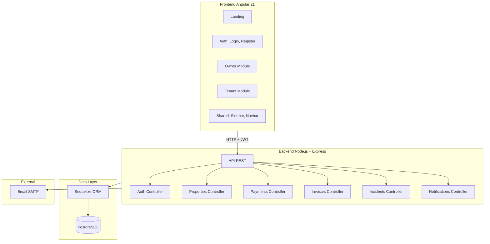

# RentaHogar

## 1. Resumen ejecutivo

**RentaHogar** es una aplicación web para la gestión integral de propiedades en alquiler. Permite a los propietarios centralizar la administración de inmuebles, inquilinos, pagos, facturas e incidencias; y a los inquilinos consultar su estado de pagos, facturas y reportar incidencias desde su propio portal.

- **Producto**: Plataforma SaaS B2B/B2C para gestión de alquileres
- **Tipo**: Proyecto académico fullstack
- **Stack**: Angular 21 + Node.js/Express + PostgreSQL
- **Estado**: Implementado y operativo

---

## 2. Declaración del problema

Los propietarios de inmuebles en alquiler suelen gestionar sus propiedades de forma dispersa (hojas de cálculo, notas, emails). Esto genera:

- Pérdida de visibilidad sobre cobros pendientes, retrasos y estado de cada inquilino
- Dificultad para compartir información con inquilinos (facturas, estado de pago)
- Incidencias reportadas por canales informales (WhatsApp, llamadas) sin trazabilidad
- Falta de un único punto de acceso para propietarios e inquilinos

Los inquilinos, por su parte, necesitan:

- Conocer de forma clara su estado de pago y próximos vencimientos
- Ver el desglose de facturas (agua, electricidad, etc.) que repercuten en su alquiler
- Reportar incidencias de forma formal y con seguimiento

---

## 3. Visión del producto

Proporcionar una plataforma única donde propietarios e inquilinos gestionan el ciclo completo del alquiler de forma sencilla, transparente y profesional, con notificaciones automáticas y acceso 24/7.

---

## 4. Objetivos y métricas de éxito

| Objetivo | Métrica |
|----------|---------|
| Reducir tiempo de gestión | Uso diario del dashboard por propietarios |
| Transparencia con inquilinos | Inquilinos activos consultando su portal |
| Trazabilidad de incidencias | % de incidencias reportadas vs resueltas con seguimiento |
| Fiabilidad técnica | Disponibilidad de la API y tiempos de respuesta |

---

## 5. Personas de usuario

### Propietario (Owner)

- Gestiona una o varias propiedades
- Necesita control de cobros, retrasos y facturas
- Quiere registrar inquilinos y asignarlos a propiedades
- Debe resolver incidencias reportadas por inquilinos

### Inquilino (Tenant)

- Vive en una propiedad gestionada por un propietario
- Necesita ver su alquiler, facturas y estado de pago
- Quiere reportar incidencias y tener feedback
- Accede vía credenciales enviadas por el propietario

---

## 6. Funcionalidades por rol

### 6.1 Propietario

| Funcionalidad | Descripción | Estado |
|---------------|-------------|--------|
| Dashboard | Resumen de alquiler mensual/anual, cobros retrasados/pendientes/cobrados, incidencias abiertas, grid de propiedades con inquilinos | Implementado |
| Propiedades | CRUD de propiedades (nombre, dirección, tipo, alquiler, habitaciones, baños, m², descripción). Soporte alquiler completo o por habitaciones | Implementado |
| Inquilinos | Registrar inquilinos (envío automático de credenciales por email). Asignar/desvincular de propiedades | Implementado |
| Pagos | Crear pagos mensuales, marcar como cobrado, ver resumen, alertas por días de retraso (verde/amarillo/rojo) | Implementado |
| Facturas | Registrar facturas de suministros (agua, gas, electricidad, internet, comunidad, seguro, otros) con documento adjunto. Marcar como pagada | Implementado |
| Incidencias | Ver incidencias reportadas por inquilinos, actualizar estado (abierta → en progreso → resuelta → cerrada) | Implementado |
| Notificaciones | Centro de notificaciones (nuevas incidencias, pagos, recordatorios) | Implementado |
| Búsqueda global | Buscar propiedades, inquilinos y pagos desde el dashboard | Implementado |
| Perfil | Ver y editar datos personales | Implementado |
| Eliminar cuenta | Borrado de cuenta de usuario | Implementado |

### 6.2 Inquilino

| Funcionalidad | Descripción | Estado |
|---------------|-------------|--------|
| Dashboard | Info del casero, alquiler mensual, total con facturas, compañeros de vivienda, estado de pago (colores), incidencias, facturas del mes, gráfico anual de facturas | Implementado |
| Estado de pago | Indicador visual: al día, pendiente o X días de retraso | Implementado |
| Facturas | Tabla/móvil cards con facturas del mes, detalle con documento (imagen/PDF), total facturas | Implementado |
| Gráfico anual | Resumen de facturas (agua, electricidad, internet, gas) por mes | Implementado |
| Incidencias | Ver incidencias de la vivienda, reportar nueva (envío email al propietario) | Implementado |
| Perfil | Ver y editar datos personales | Implementado |

---

## 7. Requisitos funcionales detallados

### 7.1 Autenticación y autorización

- Registro solo como propietario (email, contraseña, nombre)
- Login con JWT; token en header Authorization
- Inquilinos creados por propietarios; reciben email con credenciales
- Cambio de contraseña forzado para inquilinos nuevos (`mustChangePassword`)
- Guards: `authGuard`, `ownerGuard`, `tenantGuard`, `guestGuard`, `forceChangePasswordGuard`
- Eliminación de cuenta con borrado de datos asociados

### 7.2 Propiedades

- Tipos: apartamento, casa, estudio, habitación, local comercial
- Dirección: calle, ciudad, código postal, país opcional
- Alquiler: mensual; modo `full` (alquiler único) o `rooms` (alquiler por habitación)
- Campos: habitaciones, baños, m², descripción
- Asignación múltiple de inquilinos por propiedad

### 7.3 Pagos

- Estados: `pending`, `paid`, `overdue`
- Campos: inquilino, propiedad, importe, mes/año, fecha vencimiento, fecha pago
- Niveles de retraso (colores): verde (<3 días), amarillo (3-5), rojo (>5)
- Tareas programadas (cron) para marcar pagos vencidos como `overdue`

### 7.4 Facturas

- Tipos: water, gas, electricity, internet, community, insurance, other
- Periodo: `periodStart` / `periodEnd` (mes, año)
- Documento adjunto opcional (subida Multer)
- Estado: pagada / pendiente
- Inquilinos ven facturas de su propiedad

### 7.5 Incidencias

- Tipos: plumbing, electrical, structural, appliance, heating, pest, other
- Prioridades: low, medium, high, urgent
- Estados: open, in_progress, resolved, closed
- Notas del propietario al resolver
- Email automático al propietario al crear incidencia

### 7.6 Notificaciones

- Tipos: incident, payment, reminder, welcome, general
- Centro de notificaciones en UI
- Marcar como leída, leer todas, eliminar

---

## 8. Requisitos no funcionales

| Categoría | Requisito |
|-----------|------------|
| Rendimiento | API con tiempos de respuesta aceptables; paginación en listados |
| Seguridad | Contraseñas hasheadas (bcrypt), JWT, validación de entrada (express-validator) |
| Disponibilidad | Acceso web 24/7; CORS configurado para frontend |
| Usabilidad | UI responsive (dashboards propietario e inquilino adaptados a móvil) |
| Mantenibilidad | Código TypeScript, ESLint, Prettier; estructura modular backend/frontend |

---

## 9. Modelo de datos (entidades principales)

```mermaid
erDiagram
    User ||--o{ Property : owns
    User ||--o{ TenantAssignment : tenant
    Property ||--o{ TenantAssignment : has
    TenantAssignment ||--o{ Payment : generates
    Property ||--o{ Invoice : has
    User ||--o{ Incident : reports
    Property ||--o{ Incident : belongs_to
    User ||--o{ Notification : receives

    User {
        uuid id PK
        string fullName
        string email UK
        string password
        enum role owner|tenant
        bool mustChangePassword
    }

    Property {
        uuid id PK
        uuid owner FK
        string name
        jsonb address
        string type
        float monthlyRent
        string rentMode full|rooms
    }

    Payment {
        uuid id PK
        uuid tenant FK
        uuid property FK
        float amount
        int month year
        date dueDate paidDate
        enum status pending|paid|overdue
    }

    Invoice {
        uuid id PK
        uuid property FK
        string type
        float amount
        jsonb periodStart periodEnd
        string documentUrl
    }

    Incident {
        uuid id PK
        uuid tenant FK
        uuid property FK
        string title description
        string type priority status
    }
```

---

## 10. Arquitectura técnica



### Stack

- **Frontend**: Angular 21, standalone components, RxJS, Chart.js, SCSS
- **Backend**: Node.js 18+, Express, TypeScript, PostgreSQL, Sequelize, bcrypt, JWT, nodemailer, multer, node-cron
- **Herramientas**: ESLint, Prettier, tsx

---

## 11. Alcance

### Dentro del alcance actual

- Gestión completa para propietarios e inquilinos descrita anteriormente
- Landing pública, autenticación, guards por rol
- API REST documentada en [backend/README.md](backend/README.md)

### Fuera del alcance

- Pagos online (stripe, PayPal, etc.)
- Firma digital de contratos
- Multiidioma
- App móvil nativa
- Panel de administrador global

---

## 12. Supuestos y restricciones

- El sistema es monolítico (backend único, base de datos única)
- Solo existirá un propietario por cuenta; no hay gestión multi-propietario
- Los inquilinos son creados exclusivamente por propietarios; no hay auto-registro de inquilinos
- La base de datos es PostgreSQL (no MongoDB; la landing menciona MongoDB por error)
- Proyecto con fines académicos; no producción comercial

---

## 13. Referencias

- [Backend README](backend/README.md): Endpoints API, scripts, configuración
- [Frontend features](frontend/src/app/features): Estructura de módulos
- [Core models](frontend/src/app/core/models/interfaces.ts): Interfaces TypeScript
